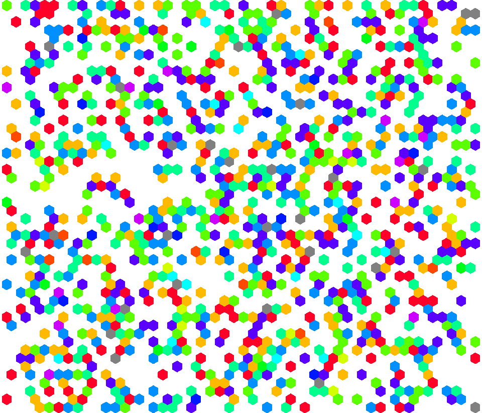
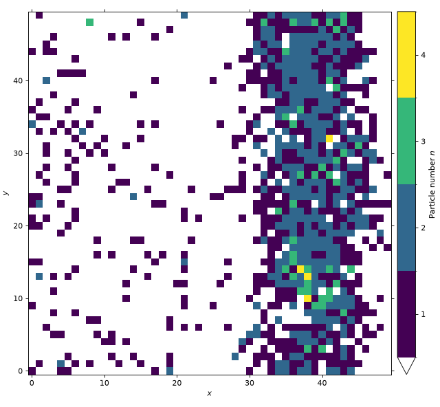
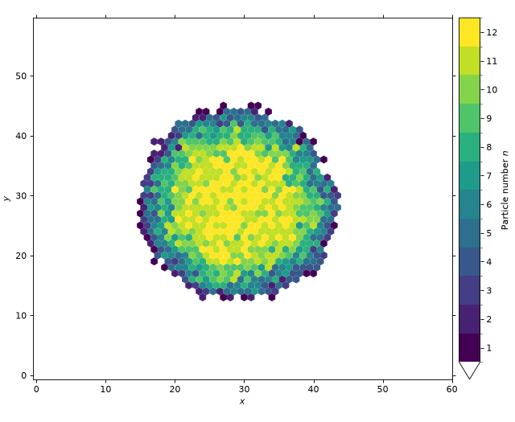

# BioLGCA

[](https://github.com/sisyga/biolgca/actions/workflows/ci.yml)

[](LICENSE.txt)

**Simulate how cells move, align, grow and evolve, in a few lines of Python.**

<p align="center">
  
</p>

BioLGCA implements biological lattice-gas cellular automata (BIO-LGCA). Each
lattice site has one channel per direction of movement and optional rest
channels, so the model tracks how many cells are at each site and where they
are heading. The rules are local and stochastic, which makes simulations fast
and the models accessible to mathematical analysis
([Deutsch et al. 2021](https://doi.org/10.1371/journal.pcbi.1009066)).

With BioLGCA you can:

- combine built-in mechanisms: random walk, alignment, chemotaxis, contact
  guidance, aggregation, birth and death, go-or-grow and phenotype switching;
- write a new interaction as a decorated Python function and use it like a built-in;
- track individual cells with heritable traits to study evolution;
- watch a model run in a notebook while you change its parameters with sliders;
- run on 1D, square, hexagonal and 3D lattices; and
- save every model as a JSON file that reruns from its seed with the same data
  (given the same BioLGCA and dependency versions).

## Why BioLGCA

BioLGCA is for researchers and students in mathematical and theoretical
biology who model collective cell migration, tissue growth, pattern formation
or the evolution of cell populations, and for courses that teach these
topics. LGCA describe cells by their numbers and directions of movement on a
lattice, so a model is a short list of local stochastic rules that can be
simulated on large lattices and analysed with mean-field and stability
methods (Deutsch et al. 2021).

General-purpose frameworks for cell-based models, such as Morpheus and
CompuCell3D (cellular Potts models), PhysiCell (off-lattice agents) and Chaste
(several cell-based model types, including an on-lattice cellular automaton),
couple cells to fields in many ways but do not offer the velocity-channel state space of LGCA, in which
alignment, chemotaxis and go-or-grow switching are rules for the
reorientation of channel states and in which mean-field equations can be
derived systematically from the rules. BioLGCA provides this model class as a
library: the rules of the BIO-LGCA literature as composable building blocks,
a checked contract for new rules, model files that rerun from their seed, parameter
sweeps, and a [model zoo](docs/source/zoo/index.rst) that reproduces
published LGCA models with these rules.

## Quick start

1. [Install uv](https://docs.astral.sh/uv/getting-started/installation/), which
   manages Python and all dependencies for you:

   ```bash
   # macOS and Linux
   curl -LsSf https://astral.sh/uv/install.sh | sh
   # Windows (PowerShell)
   powershell -ExecutionPolicy ByPass -c "irm https://astral.sh/uv/install.ps1 | iex"
   ```

2. Get BioLGCA and open JupyterLab:

   ```bash
   git clone https://github.com/sisyga/biolgca.git
   cd biolgca
   uv sync
   uv run jupyter lab
   ```

   If uv reports that it cannot find Python (some Linux distribution packages
   do not download it automatically), run `uv python install` first.

3. Paste this into a notebook cell to produce the flocks shown above:

   ```python
   from lgca import get_lgca

   lgca = get_lgca(geometry="hex", dims=(50, 50), interaction="alignment",
                   beta=3, density=0.5, seed=2)
   lgca.timeevo(timesteps=100, record=True)
   lgca.plot_flux()  # colour shows the direction of motion
   ```

   `beta` sets how strongly cells align with their neighbours. Try `beta=0`
   (no alignment) or `density=0.2` (sparser cells) and run again.

## Build a model from mechanisms

For a study you will want every assumption written down. A `ModelSpec`
describes the lattice, initial state, time and seed, and the list of
interactions. Here cells align with their neighbours and follow an attractant
gradient; both cues enter one stochastic decision per site:



```python
import numpy as np
from lgca.model import AnalysisSpec, ModelSpec, SpaceSpec, StateSpec, TimeSpec, run_model
from lgca.pipeline import (InteractionPipelineSpec, ReorientationSpec,
                           ReorientationTermSpec)
from lgca.simulation import DensityRecorder

x = np.arange(50)[:, None] * np.ones((50, 50))
signal = np.exp(-((x - 40) / 15) ** 2)  # attractant peaks at x = 40

spec = ModelSpec(
    space=SpaceSpec(geometry="square", dims=(50, 50), boundary="reflecting"),
    state=StateSpec(density=0.5, fields={"signal": signal}),
    time=TimeSpec(steps=100, seed=1),
    dynamics=InteractionPipelineSpec(operators=[
        ReorientationSpec(terms=[  # both cues enter one stochastic decision
            ReorientationTermSpec(name="polar_alignment", beta=1.5),
            ReorientationTermSpec(name="chemotaxis", beta=20, parameters={"field": "signal"}),
        ]),
    ]),
    analysis=AnalysisSpec(observers=[DensityRecorder()]),  # what to record
)
result = run_model(spec)
result.lgca.plot_density()
```

Save the model with `save_model_spec(spec, "model.json")` from `lgca.model`.
Anyone with the same versions of BioLGCA and its dependencies can then rerun it
from the command line and get identical data:

```bash
uv run biolgca run model.json --output runs/chemotaxis-001
```

The run directory contains the resolved model, the BioLGCA version and the
recorded densities in `measurements.npz`.

## Growth and phenotype switching



Interactions can also create and remove cells. In the go-or-grow model, cells
either migrate or rest and divide, and crowding changes which they do. One
fully occupied node grows into a spheroid:

```python
spec = ModelSpec(
    space=SpaceSpec(geometry="hex", dims=(60, 60)),
    state=StateSpec(
        restchannels=6,  # resting cells sit in rest channels, moving cells in velocity channels
        initializer={"name": "region", "parameters": {"extent": 1, "density": 12}},
    ),
    time=TimeSpec(steps=90, seed=3),
    dynamics=InteractionPipelineSpec(operators=[
        {"name": "go_or_rest", "parameters": {"kappa": -4, "theta": 0.5}},
        {"name": "go_or_grow.growth", "parameters": {"r_b": 0.2, "r_d": 0.01}},
        {"name": "random_walk", "parameters": {"channels": "velocity"}},
    ]),
)
run_model(spec).lgca.plot_density()
```

Each step, cells switch between moving and resting, die, resting cells
divide, and moving cells pick new directions. With `kappa=4`, crowded cells
rest instead, and the same small colony shrinks: growth then needs a minimum
population, an Allee effect that emerges from the switching rule.

<br clear="right">

## Write your own interaction

A new rule is a Python function of the lattice state. The state offers
operations with a fixed meaning per cell, such as "every cell dies with
probability p", which work with and without volume exclusion and for any
number of species. The decorator registers the rule under its name, with its
parameters taken from the signature. This rule kills cells more often on
crowded nodes; the loop compares three death rates:

```python
from lgca import interaction
from lgca.simulation import PopulationRecorder


@interaction(kind="birth_death", families=("classical", "nove"))
def crowding_death(state, r_d=0.1):
    """Each cell dies with probability r_d * (cells on its node) / (node capacity)."""
    state.remove_cells(r_d * state.density / state.capacity)


for r_d in (0.0, 0.2, 0.5):
    spec = ModelSpec(
        space=SpaceSpec(geometry="square", dims=(40, 40)),
        state=StateSpec(density=1, restchannels=2),
        time=TimeSpec(steps=100, seed=1),
        dynamics=InteractionPipelineSpec(operators=[
            {"name": "birth_death", "parameters": {"birth_rate": 0.1}},
            crowding_death(r_d=r_d),
            {"name": "random_walk"},
        ]),
        analysis=AnalysisSpec(observers=[PopulationRecorder()]),
    )
    result = run_model(spec, showprogress=False)
    print(f"r_d = {r_d}: {result.data['population'][-1]} cells after 100 steps")
```

`lgca.testing.check_interaction(crowding_death)` runs a rule on every lattice
and model family it claims to support and reports what goes wrong, from lost
cells to unseeded random numbers. Movement biases are written the same way
with `@reorientation_term`. The
[custom interaction guide](docs/source/how_to/custom_interactions.rst) shows
growth rules, movement biases and a deterministic collision rule, and tutorial
6 how to test a rule and share it together with a model.

## Learn

Eight notebooks take you from the first random walk to a reproducible project
and to cells that act on the molecules around them.
Every model is built in visible cells and the notebooks run in CI, so they
are checked against the current code.

| Lesson | You will learn to |
| --- | --- |
| [1. Fundamentals](docs/source/tutorials/01_fundamentals.ipynb) | set up a lattice, run a random walk, compare boundaries and seeds |
| [2. Collective movement](docs/source/tutorials/02_collective_movement.ipynb) | compare alignment mechanisms and measure order |
| [3. Combining cues](docs/source/tutorials/03_combining_interactions.ipynb) | combine alignment, chemotaxis and contact guidance; sweep parameters |
| [4. Population dynamics](docs/source/tutorials/04_population_dynamics.ipynb) | add birth, death and phenotype switching; go-or-grow |
| [5. Evolutionary LGCA](docs/source/tutorials/05_evolutionary_lgca.ipynb) | track heritable traits across stochastic replicates |
| [6. Student project](docs/source/tutorials/06_student_project.ipynb) | write, test and share your own interaction |
| [7. Oxygen-limited growth](docs/source/tutorials/07_oxygen_limited_growth.ipynb) | couple cells to a field they take up; let consumption evolve |
| [8. Aggregation](docs/source/tutorials/08_aggregation.ipynb) | find the onset of chemotactic aggregation toward a secreted signal, and watch it live |

The [example gallery](docs/source/example_gallery.rst) collects further
ready-to-run models, one per question, and an advanced example: a
[tumour spheroid](docs/source/examples/tumour_spheroid.ipynb) of proliferating,
quiescent and necrotic cells in the oxygen they consume, in 2D and 3D, with
parameters from measurements.

## Model types

| | Classical | Identity-based (individual cell traits) |
| --- | --- | --- |
| **Volume exclusion** (at most one cell per channel) | ✓, also with several species | ✓ |
| **No volume exclusion** (many cells per channel) | ✓, also with several species | ✓ |

All model types run on 1D, square and hexagonal lattices, and on cubic and 3D
Moore lattices. 3D rendering uses Mayavi, which is optional: install it with
`uv sync --extra plot3d`.

## Other ways to install

Without uv, install BioLGCA into any Python 3.11+ environment, from a clone
or directly from GitHub (BioLGCA is not on PyPI yet):

```bash
python -m pip install -e ".[notebooks]"   # in the clone; JupyterLab; also ".[yaml]" or ".[plot3d]"
python -m pip install "biolgca @ git+https://github.com/sisyga/biolgca"   # without a clone
```

This picks the newest compatible versions of the dependencies. `uv sync` instead
installs the exact versions in `uv.lock`, which the test suite runs against.
The runtime dependencies are NumPy, SciPy, pyamg, threadpoolctl, tqdm,
Matplotlib, pandas and ipywidgets; `biolgca examples list` checks that the
installation works.

## Questions and contributing

- **Questions** about using BioLGCA, and **bug reports** and **ideas**: open
  an issue on the [issue tracker](https://github.com/sisyga/biolgca/issues),
  which offers templates for each.
- **Contributions** are welcome: [CONTRIBUTING.md](CONTRIBUTING.md) explains
  how to set up the development environment, run the tests and the docs
  build, and propose a new interaction.
- Everyone taking part follows the [code of conduct](CODE_OF_CONDUCT.md).

The checks, run from the repository root after `uv sync`:

```bash
uv run pytest -q               # test suite
uv run python docs/build.py    # documentation, executes all tutorials
```

User-facing changes are recorded in [CHANGELOG.md](CHANGELOG.md).

## History and use of AI tools

BioLGCA has been developed at TU Dresden since 2018. The code base before
2.0, kept on branch [`v1`](https://github.com/sisyga/biolgca/tree/v1), grew
from 2018 alongside the research that used it, with contributions from the
people listed under [Acknowledgements](#acknowledgements), and was modernised
in 2025. Version 2.0 (2026) rewrote the package around declarative model specifications, a rule contract
and the model zoo.

Since 2025 the package has been developed with the help of generative AI
coding assistants (OpenAI Codex, GitHub Copilot and Anthropic's Claude Code),
which wrote code, tests and documentation under the direction of the
maintainer. Codex work was merged from `codex/` branches, Copilot work is
authored by `copilot-swe-agent[bot]`, and commits written with Claude Code
since September 2026 carry a `Co-Authored-By` trailer. The
results are checked independently of the code that produced them: the test
suite compares the new rules statistically with the frozen interaction
functions of the code before 2.0 (`tests/legacy/`) and with analytic expectations,
every rule is checked against the conservation laws of its kind, and each
zoo notebook reproduces a result of its paper at reduced size and states what
differs.

## Citing

If you use BioLGCA in published work, please cite:

> Syga S, Nava-Sedeño JM, Deutsch A (2026). A novel cellular automaton approach
> for modeling genotypic and phenotypic heterogeneity in cell systems.
> *The European Physical Journal Special Topics*.
> <https://doi.org/10.1140/epjs/s11734-026-02186-1>

The BIO-LGCA modelling class is described in:

> Deutsch A, Nava-Sedeño JM, Syga S, Hatzikirou H (2021). BIO-LGCA: A cellular
> automaton modelling class for analysing collective cell migration.
> *PLoS Computational Biology* 17(6): e1009066.
> <https://doi.org/10.1371/journal.pcbi.1009066>

## Acknowledgements

BioLGCA is maintained by Simon Syga. Bianca Güttner
([@GuettnerBianca](https://github.com/GuettnerBianca)) co-authored the code
before 2.0. Code was also contributed by
[@Franzi2729](https://github.com/Franzi2729),
Marcus Krellner ([@krelli89](https://github.com/krelli89)),
[@harishpjain](https://github.com/harishpjain) and Mateo Larralde
([@mateolarr](https://github.com/mateolarr)). The models build on
the BIO-LGCA work of Andreas Deutsch, Josué Manik Nava-Sedeño, Haralampos
Hatzikirou and colleagues.

## License

BSD 3-clause, see [LICENSE.txt](LICENSE.txt). Copyright (C) 2018–2026
Technische Universität Dresden.
